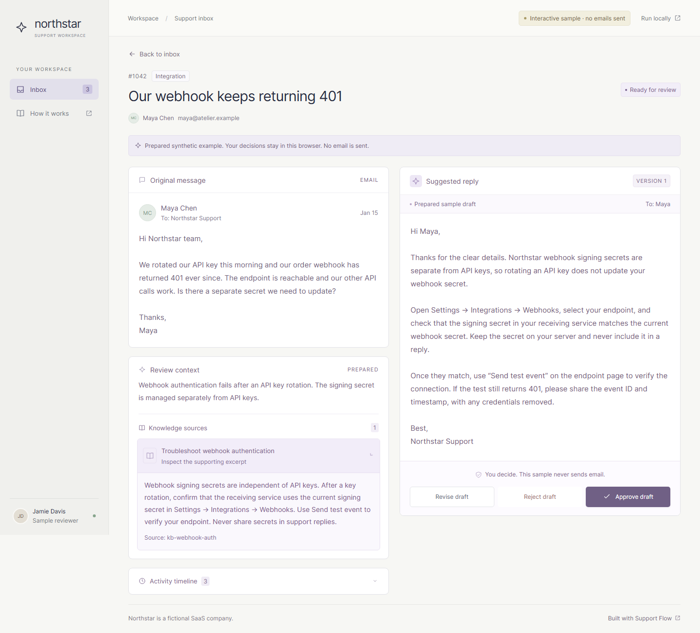
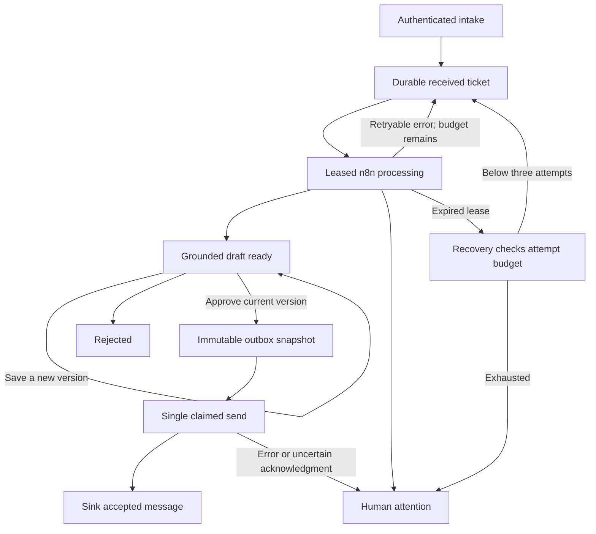

# Support Flow

A human-reviewed support inbox for a fictional SaaS company. n8n classifies tickets, retrieves PostgreSQL/pgvector knowledge, and prepares an OpenAI draft. A React workspace lets a reviewer inspect sources, revise the reply, and approve a specific version before an immutable outbox can dispatch it.

**Two ways to explore:** [Try the demo](#try-the-demo) uses prepared fictional conversations in your browser. [Run the boilerplate](#run-the-boilerplate) starts the actual API, database, n8n workflows and local email sink.

**Verification status:** implementation and independent verification are in progress. See [the validation record](docs/validation.md) for observed results and blockers. No live OpenAI, Gmail or Slack execution is claimed.



## Try the demo

Public GitHub Pages publication has not yet been verified. Run the same sample locally with Node.js **22 LTS** and npm 10:

```sh
git clone https://github.com/mithundas79/support-flow.git
cd support-flow
npm ci
npm run build
npm run preview --workspace @support-flow/web -- --host 127.0.0.1 --port 4173
```

Open [http://127.0.0.1:4173/support-flow/](http://127.0.0.1:4173/support-flow/).

- Open Maya's webhook question, inspect the knowledge excerpt, revise the draft and approve the new version.
- Open Leo's SSO question to see a clarification request when important details are missing.
- Open Amara's billing request to see specialist escalation and blocked routine approval.
- Try search, filters, rejection reasons and **Reset demo**. Decisions persist in this browser; reset restores the three examples.

The sample uses prepared synthetic messages, article matches and drafts. **It makes no live AI calls and sends no email.** Adding a sample email creates a manual-review example without running retrieval. Do not enter real customer information. Browser storage is a convenience, not a secure support database.

## Run the boilerplate

This is a local, single-reviewer reference implementation. Prerequisites: Git, Node.js 22 LTS, npm 10, Docker with Compose v2, and a running Linux-container engine. The default stack uses **controlled OpenAI fixtures and Mailpit**. No OpenAI, Gmail or Slack account is needed to exercise it.

### 1. Install and configure

After cloning, run `npm ci` and `npm run build`. The build prepares the shared contract/core packages for the host web server as well as the application artifacts. Copy `.env.example` to `.env`, then replace its local password and token placeholders. Keep `.env` out of Git. Use distinct random values for `REVIEWER_TOKEN`, `WORKFLOW_TOKEN` and `N8N_ENCRYPTION_KEY`; reviewer and workflow tokens must differ and contain at least 24 characters.

| Setting | Local use |
| --- | --- |
| `POSTGRES_PASSWORD` | Local database password |
| `REVIEWER_TOKEN` | Establishes the human reviewer's session; never saved in browser storage |
| `WORKFLOW_TOKEN` | Separate n8n webhook/internal API bearer credential |
| `N8N_ENCRYPTION_KEY` | Encrypts credentials in the persistent n8n volume; preserve across restarts |
| `APP_ORIGIN` | Exact live UI origin; default `http://localhost:5173` |
| `OPENAI_BASE_URL` | Default is the local provider fixture |
| `AI_PROVIDER_MODE` | `fixture` by default; explicit `openai` opt-in for a live evaluation |
| `OPENAI_API_KEY` | Not needed for fixtures; a server-side key is required only for optional live mode |
| `OPENAI_TEXT_MODEL`, `OPENAI_EMBEDDING_MODEL` | Server-side model selections; embeddings must remain 1536-dimensional |
| `NORTHSTAR_SMTP_HOST` | Default `mailpit`; acceptance uses `provider-fixture` to inject SMTP ambiguity |
| `DELIVERY_ALLOWED_DOMAINS` | Recipient allowlist; defaults to fictional/example domains |
| `SLACK_ENABLED`, `SLACK_WEBHOOK_URL` | Optional server-side notification; disabled by default |

### 2. Start services and import workflows

```sh
docker compose up -d --build --wait
docker compose exec -T n8n node /opt/automation/scripts/import-workflows.mjs
docker compose restart n8n
```

The API migrates its tables and seeds the fictional knowledge articles at startup. Ingest creates embeddings and stores them in pgvector. The import command creates local webhook/SMTP credentials, imports and publishes five workflows, and leaves secrets out of their JSON exports. Restart n8n to register the published webhook routes. Use this bootstrap in the dedicated local n8n instance, not a shared instance containing unrelated workflows.

Wait for [n8n readiness](http://localhost:5678/healthz/readiness) to return HTTP 200 after restarting before invoking ingest.

```sh
node automation/scripts/invoke-workflow.mjs ingest
```

| Service | Local address | Purpose |
| --- | --- | --- |
| Reviewer API | [localhost:3000/health](http://localhost:3000/health) | Database readiness; reviewer/internal endpoints use separate authentication |
| n8n editor | [localhost:5678](http://localhost:5678) | Inspect graph executions; complete local owner setup when prompted |
| Mailpit | [localhost:8025](http://localhost:8025) | Inspect locally accepted messages |
| Provider fixture | `127.0.0.1:4010` | Controlled responses and fault injection |
| PostgreSQL | `127.0.0.1:5432` | Application data; n8n uses separate SQLite storage in `n8n_data` |

Published service ports bind to loopback. Back up both `postgres_data` (tickets, jobs, reviews and outbox) and `n8n_data` (SQLite, credentials and workflow executions), together with the n8n encryption key. Application PostgreSQL is not a backup of n8n state.

### 3. Start the real review workspace

Set `VITE_API_MODE=live` for the web development process, then start it:

```sh
# macOS/Linux
VITE_API_MODE=live npm run dev:web
```

```powershell
# PowerShell
$env:VITE_API_MODE = 'live'
npm run dev:web
```

Open [http://localhost:5173/support-flow/](http://localhost:5173/support-flow/) and sign in with your local reviewer token. Vite proxies `/api` to the API; the browser origin must match `APP_ORIGIN`. The sample preview on port 4173 remains a browser-only demo.

Use **New ticket** with fictional details or submit the intake DTO through the authenticated n8n webhook. The process workflow polls every minute. To process a particular ticket immediately, invoke `process` with its ID. Inspect source excerpts before approving. The dispatch schedule picks up approved snapshots and sends to Mailpit.

Webhook input is `{externalId, subject, body, customerName, customerEmail}`. Reusing an external ID with identical content returns the existing ticket; different content is a conflict. See [the workflow/API contract](automation/INTERNAL_API.md) for authenticated payloads and callbacks.

### Optional real providers

For live OpenAI calls, set `AI_PROVIDER_MODE=openai`, `OPENAI_BASE_URL=https://api.openai.com/v1` and a valid server-side `OPENAI_API_KEY`, choose text/embedding models in `.env`, and recreate **both API and n8n** with `docker compose up -d --force-recreate api n8n`. Re-ingest the KB with the chosen embedding model before processing tickets. Stored vectors require **1536 dimensions**. A fixture run does not verify a real model's behavior. The opt-in synthetic evaluation is `RUN_LIVE_OPENAI=1 node automation/scripts/live-evaluation.mjs --limit=3` (set that variable in `.env` or your shell on Windows). It drafts only and never approves or dispatches.

Gmail is opt-in. The inactive [Gmail intake adapter](automation/optional/northstarGmailIntake.json) is excluded from default import. In a dedicated support mailbox, label incoming messages `NorthstarSupport`; create a Gmail OAuth2 credential in n8n, import this adapter through the editor, bind that credential to both Gmail nodes, review its polling query and publish deliberately. Keep `GMAIL_MAILBOX_KEY` stable for that mailbox. It normalizes one plain-text message and marks it read only after durable intake; immutable Gmail IDs provide deduplication. Read [the adapter setup and limits](automation/README.md) before enabling it. Normalization fixtures do not verify Gmail OAuth, polling or read-state changes.

For optional outgoing Gmail, configure a separate authenticated Gmail SMTP credential in a workflow copy and bind it to dispatch, preserving the outbox snapshot and disabled retries. Set `DELIVERY_MODE=gmail`, expand `DELIVERY_ALLOWED_DOMAINS` only for intended recipients, and recreate API/n8n so the runtime display matches the configuration. Bootstrap imports only local Mailpit credentials. Gmail authentication, SMTP sending and inbox delivery have not been live verified.

Slack notifications are optional and do not authorize sending customer email. Keep its webhook URL server-side and enable it explicitly. Never place a provider key, reviewer token or workflow token in a `VITE_*` variable or browser bundle.

## How state and recovery work

The API owns PostgreSQL transactions, reviewer sessions, versions, audit events and the outbox. n8n owns provider calls and graph execution. The browser never calls OpenAI, Gmail or Slack directly. Cited source IDs must come from the retrieved snapshot for the current processing lease.



Edits and decisions send `expectedVersion`. Stale edits/approvals and repeated approval fail explicitly. Rejected tickets cannot enter routine delivery. Sensitive account/billing actions and drafts without supporting sources require specialist attention, even if a model suggests a routine reply.

Processing jobs allow three durable attempts. Restarts preserve pending jobs; expired processing leases can be requeued within the budget. Recovery runs every five minutes, or invoke `recover` manually through the authenticated helper.

Dispatch claims the approved snapshot once. **SMTP acceptance is not proof of customer inbox delivery.** A send error or worker crash after possible acceptance requires human attention and blocks automatic resend. Inspect Mailpit/the provider and the audit timeline before deliberate follow-up. There is no general-purpose retry/reconciliation UI or exactly-once email guarantee.

## Test and inspect

```sh
npm run build
npm run typecheck
npm test
npx playwright install chromium
npm run test:e2e
node automation/scripts/run-integration.mjs
```

The last command requires free local ports 3000, 4010, 5432, 5678 and 8025. It runs a disposable real Docker stack with controlled providers, imports the actual workflows, exercises database/API/n8n integration and the authenticated browser, then cleans up its isolated resources. It must not use configured live provider credentials. Integration checks cover duplicate intake races, version conflicts, auth/CSRF, malformed provider responses, refusal, rate limits, timeouts, citation rejection, durable recovery and ambiguous SMTP acknowledgment. See [independent acceptance instructions](tests/acceptance/README.md) and [the acceptance matrix](docs/acceptance-matrix.md).

The [fictional corpus](fixtures/tickets/labeled.json) contains 30 tickets with authored category, priority and disposition expectations; the [fictional KB](fixtures/knowledge-base/articles.json) contains ten articles. Controlled fixture label agreement is a regression check, **not measured live-model accuracy**. No representative evaluation, production load benchmark, live provider cost, Gmail delivery or Slack verification is claimed. Exact observed results belong in [validation.md](docs/validation.md).

## Limits, cost and security

Each processing attempt makes at most three provider calls: classification, query embedding and draft. Sensitive cases skip routine drafting; no-source cases request human clarification. Three durable attempts cap processing at nine calls, excluding KB ingestion. Classification/draft output limits are 600/1200 tokens; provider input is truncated to 12,000 characters, and requests have bounded timeouts. These are engineering limits, not a currency budget. Actual spend depends on models, input size, retries and provider pricing; no live cost was measured.

The boilerplate assumes one trusted reviewer and one operator. It has no organization isolation, role administration, customer-facing authentication or production deployment hardening. Reviewer sessions use HttpOnly/SameSite cookies with CSRF and exact-origin checks; workflow callbacks use a distinct bearer token. Real deployment also needs HTTPS, managed secrets, restricted n8n access, backups, monitoring, retention policy and an operational review process. n8n environment access is enabled for these local workflows, so only trusted operators should edit them.

### Stop or reset local data

`docker compose down` stops services while preserving volumes. **Reset demo** only resets browser state. To delete the disposable local database, n8n configuration, imported credentials and execution history, run `docker compose down --volumes` only after deciding that data is no longer needed. Preserve any encryption key and backups you intend to reuse.

## License

Authored code and fictional fixtures are [MIT licensed](LICENSE). n8n is separately licensed; its [own licensing terms](https://docs.n8n.io/sustainable-use-license/) apply. This repository does not relicense n8n or claim that it is MIT licensed.
